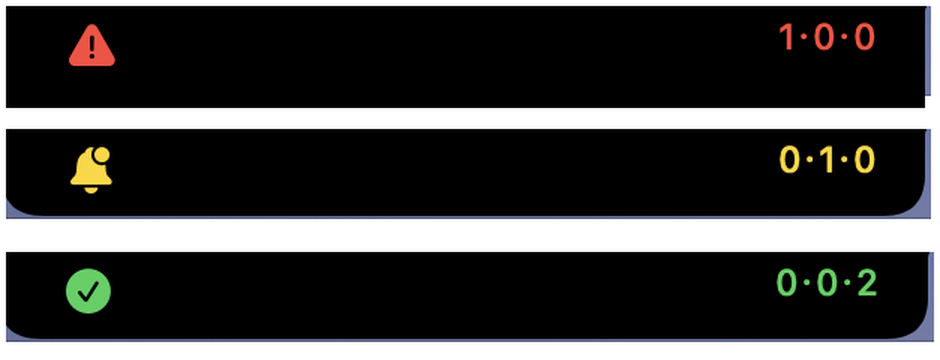
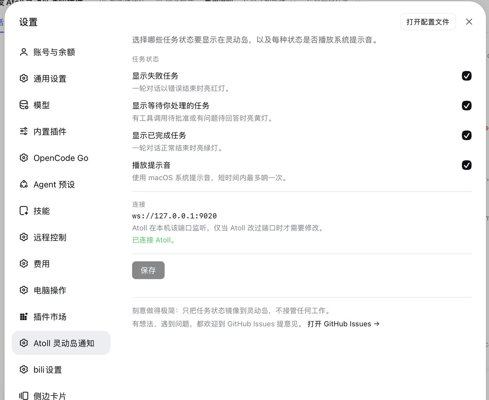

# dsh-2-atoll-notice

Mirror **DeepSeek Harness** task state into the macOS **Atoll** Dynamic Island: a task failed, a task is waiting for you, or a task just finished — one glance tells you.

> [简体中文](README.md) | English

## ⚠️ Only meaningful on macOS with Atoll

Without Atoll this plugin does nothing at all. Two requirements, both mandatory:

1. **macOS** — Atoll is macOS-only;
2. **[Atoll](https://github.com/Ebullioscopic/Atoll) installed and running** — the plugin draws into the Dynamic Island through Atoll's third-party extension protocol (a local WebSocket JSON-RPC endpoint, `127.0.0.1:9020` by default). No Atoll, no island.

On Linux or Windows the plugin is simply not needed and does nothing.

## It does one thing: notify

Deliberately minimal: it never takes over tasks, runs commands, or collects data. It only aggregates the state the Harness already produces into a single status light.

| State | Colour | Meaning |
| --- | --- | --- |
| Failed | 🔴 red | a task errored |
| Needs you | 🟡 yellow | a task is asking you a question / waiting for approval |
| Done | 🟢 green | a task finished |

All three states **coexist** inside one Dynamic Island activity; the trailing figures `failed·needs-you·done` show how many of each are current (for example `1·0·0`, or `0·0·2` for two finished tasks). The icon colour follows the most urgent non-zero state: failed > needs-you > done.



- Driven by real Host events (`agent/error`, `approval/request`, `user-questions/request`, `agent/turn-stopping`);
- A manual abort (`Ctrl+C`) counts as neither failure nor success, so it never lights up;
- Failed states expire after 15 minutes, done states after 2; when nothing is left the activity is dismissed so nothing lingers;
- An optional chime (off by default) uses a macOS system sound and is rate-limited to at most one ring in a short window.

## Install

### Option 1: mount locally (development / early access)

```bash
git clone https://github.com/chenvinc/dsh-2-atoll-notice.git
```

In your profile directory (for example `~/.dsh/profiles/web`):

1. add `"dsh-2-atoll-notice": "link:/absolute/path/dsh-2-atoll-notice"` to `dependencies` in `package.json`, then `pnpm install`;
2. append to `cordis.patch.yml`:

```yaml
- insert:
    - id: atoll-notice
      name: dsh-2-atoll-notice
```

Restart `dsh web`.

### Option 2: install from npm (recommended)

```bash
npm install dsh-2-atoll-notice --save
```

Or install `dsh-2-atoll-notice` straight from the Harness plugin manager: `dsh.bundle` mounts the Host half into the bundle patch and `dsh.client` mounts the browser half into the Web GUI.

Current release: [](https://www.npmjs.com/package/dsh-2-atoll-notice)

### Before you start

- Atoll is running;
- third-party extensions are enabled in Atoll (on by default);
- the port is `9020`; if you changed it, update it in the plugin settings too.

## Settings

Open **Settings → Atoll notices**:



- four switches: failed / needs-you / done / chime;
- connection status and port;
- a GitHub Issues link at the bottom of the page — feedback welcome.

Changes apply immediately and persist to `~/.dsh/profiles/<profile>/atoll-notice.json` (only the fields you changed).

## Agent tools

Available in any session once installed:

- `atoll_notice_status` — connection, authorization, and the three counts;
- `atoll_notice_test` — light a single state (`failure` / `attention` / `done`) to prove the pipe works;
- `atoll_notice_clear` — clear local records and dismiss the island activity.

## How it works

```
DeepSeek Harness ──events──▶ plugin Host half ──WebSocket JSON-RPC──▶ Atoll ──▶ Dynamic Island
        ▲                        127.0.0.1:9020
        └──── settings page = plugin Client half (React, its own HTTP routes) ────┘
```

- The Host half watches task events, keeps three counters, and coalesces every change into **one** Atoll activity;
- If Atoll restarts or drops the socket it reconnects (500ms → 1s → … capped at 15s) and re-presents the current state;
- The settings page only talks to the plugin's own `/api/atoll-notice/*` routes.

## Troubleshooting

- Host-half changes (`index.js`, `lib/*.js`) need a `dsh web` restart; `client.js` hot-swaps, so a page refresh is enough;
- The plugin writes its boot breadcrumbs to `~/.dsh/atoll-notice-trace.log` (`module-loaded`, `apply-enter`, `routes-mounted`, `tools-registered`, plus the browser beacons `bundle-loaded` / `card-registered` / `section-registered`);
- If the island stays dark, confirm Atoll is running, the port matches, and the switches in the settings page are on.

## Privacy

- Talks only to `127.0.0.1`, never to the network;
- Sends only the status line text (title, three counts) and icon/colour — no conversation content, error details, or file contents;
- Never reads or writes Atoll's configuration and makes no AppleScript / accessibility calls.

## Development

```bash
node --test tests/*.test.mjs   # unit tests (92)
node scripts/smoke.mjs         # light up the real Atoll (dismisses itself)
node scripts/fake-atoll.mjs    # local fake Atoll for integration tests
```

Layout: `index.js` (mounting, event binding), `lib/atoll.js` (WebSocket JSON-RPC client), `lib/state.js` (three-state ledger), `lib/format.js` (wire format), `lib/http.js` (settings API), `lib/tools.js` (agent tools), `client.js` (settings card), `docs/` (architecture and verification notes).

## Feedback

Ideas and bug reports are welcome in **[GitHub Issues](https://github.com/chenvinc/dsh-2-atoll-notice/issues)** — the settings page links there too.

## Credits and license

Atoll is built by [Ebullioscopic](https://github.com/Ebullioscopic); this plugin only adapts to its third-party extension protocol and is not affiliated with the Atoll project. MIT licensed, see [LICENSE](./LICENSE).
